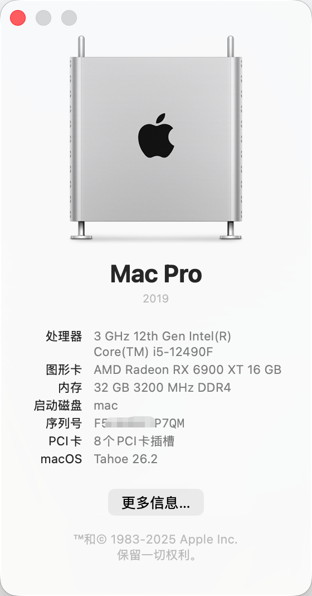
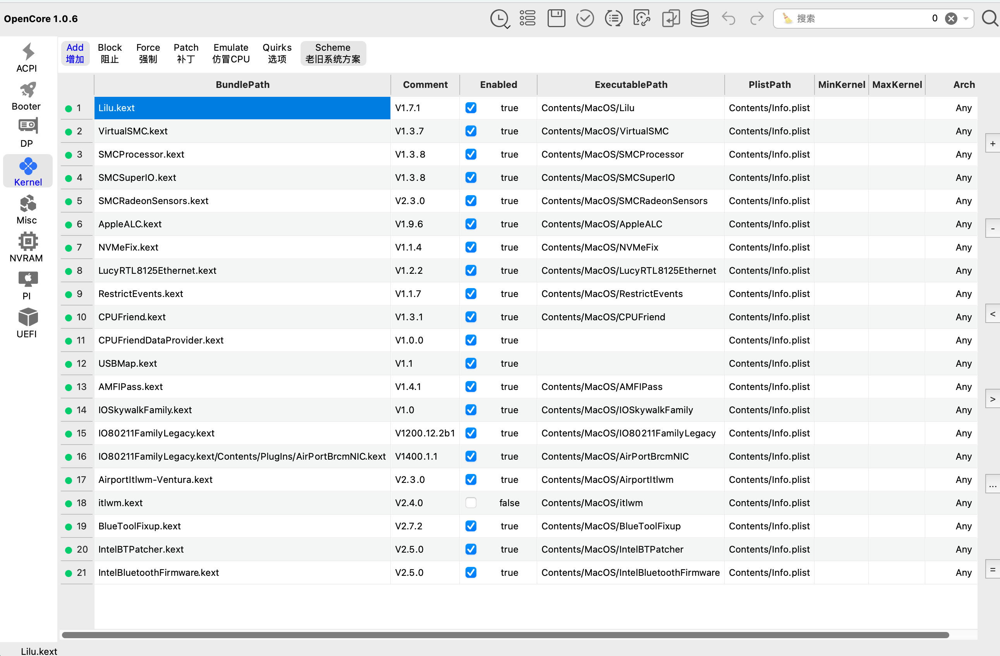
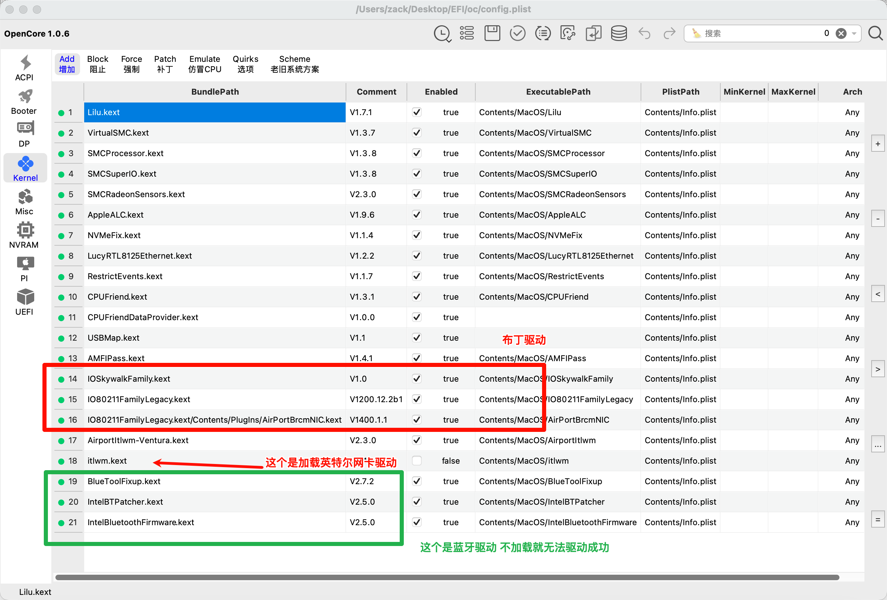
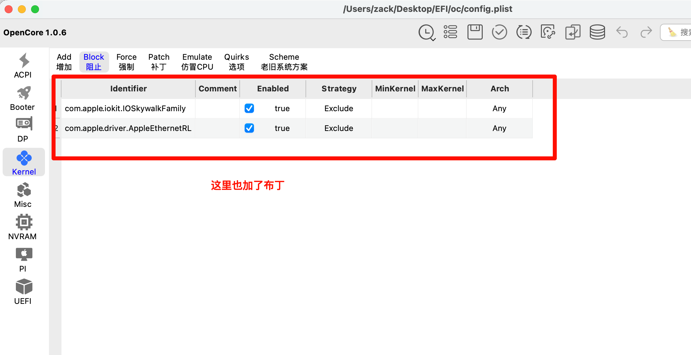
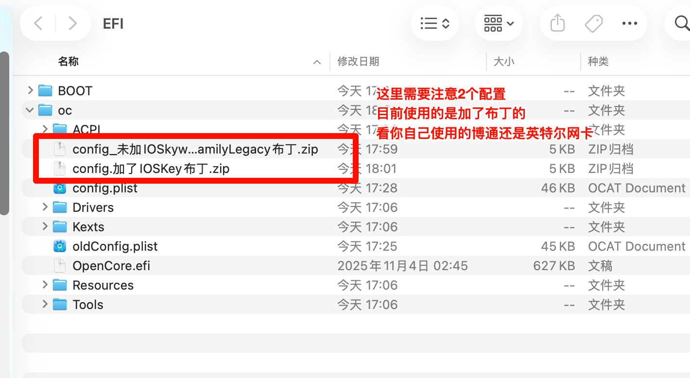
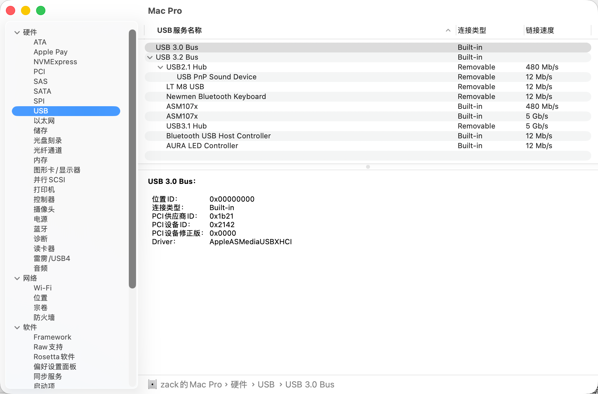
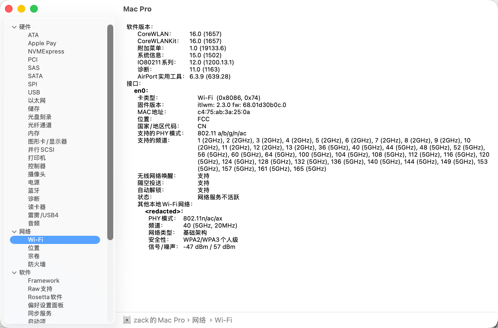
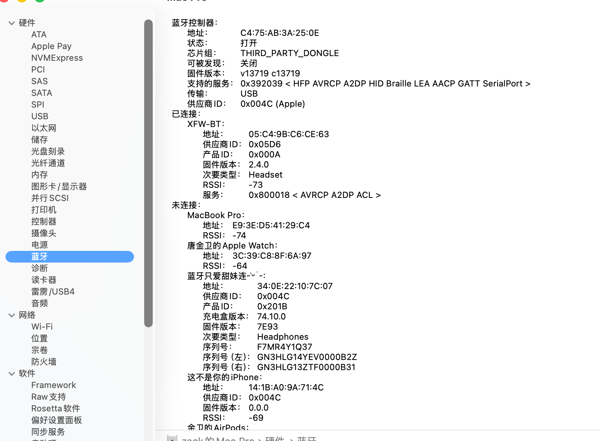

# TUF-GAMING-B660M-PLUS-WIFI-D4-i5-12490F-6900XT
在@mmccg的大佬的EFI 成功引导Tahoe26.2.0 

只能说不是很完美  留着存档

### 配置

| 配件  | 描述                               | 是否工作 | 注意 |
| ----- | ---------------------------------- | -------- | ---- |
| CPU   | Intel Core i5-12490F               | ✅        | /    |
| 主板  | 华硕TUF GAMING B660M-PLUS WIFI D4  | ✅        | /    |
| 显卡  | 蓝宝石RX6900XT超白金               | ✅        | /    |
| 内存  | 金百达普条3200 16GB*2              | ✅        | /    |
| 硬盘1 | aigo NVme SSD P2000 1TB            | ✅        | /    |
| 硬盘2 | .......                            | ✅        | /    |
| 声卡  | 板载RealtekALC897                  | ✅        | /    |
| 网卡1 | 板载Realtek8125Ethernet的2.5Gb网卡 | ✅        | /    |
| 网卡2 | 板载AX201 支持Wi-Fi6和蓝牙5.2      | ✅        | ❗    |

注意加载顺序：

